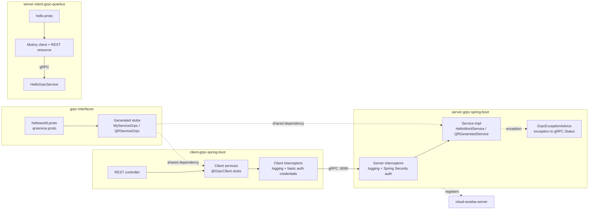

### gRPC Examples with Spring and Quarkus

[](https://github.com/AZapata27/grpc-examples/actions/workflows/ci.yml) [](https://scorecard.dev/viewer/?uri=github.com/AZapata27/grpc-examples)

This repository contains gRPC examples built with Spring and Quarkus. The examples are organized into three projects:

1. **Interface Project**: Contains the original protobuf files and generates the model and service classes in Java. This project is typically shared between the server and clients.

2. **Server Project**: Contains the actual implementation of the project and uses the interface project as a dependency. Here, gRPC services are implemented, and interceptors, events, and security are configured.

3. **Client Projects**: (Optional and potentially many) Any client projects that use pre-generated stubs to access the server.

### Project Structure

- **grpc-interfaces/**: Contains the protobuf files and generates model and service classes in Java.

- **server-grpc-spring-boot/**: Contains the implementation of the gRPC server, exception handler, security config.

- **client-grpc-spring-boot/**: Contains client projects that use pre-generated stubs to access the server.

## Architecture



### Additional Configurations

The server and client projects may contain additional configurations such as:

- **Exception Handler**: Handles exceptions by intercepting incoming and outgoing gRPC calls.
  
- **Interceptors**: To intercept incoming and outgoing gRPC calls.

- **Events**: To handle events related to the lifecycle of the server and clients.

- **Security**: To secure gRPC communications through authentication and authorization with spring security and basic auth.

- **Testing**: Validates gRPC functionality through unit and integration testing.

### Running Tests

The repository includes tests to ensure the correct operation of the gRPC services. These tests can be executed using appropriate testing tools for Spring and Quarkus projects.

Each module is an independent Maven project (Java 21). Install the contracts first, then build the rest:

```bash
(cd grpc-interfaces && mvn install)
(cd server-grpc-spring-boot && mvn verify)
(cd client-grpc-spring-boot && mvn verify)
(cd server-client-grpc-quarkus && mvn verify)
```

### License

This project is licensed under the [Apache License 2.0](LICENSE).
